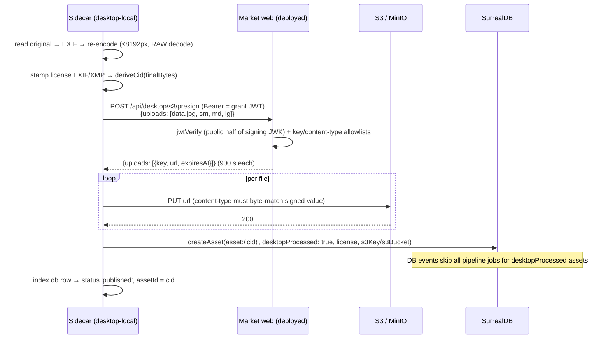
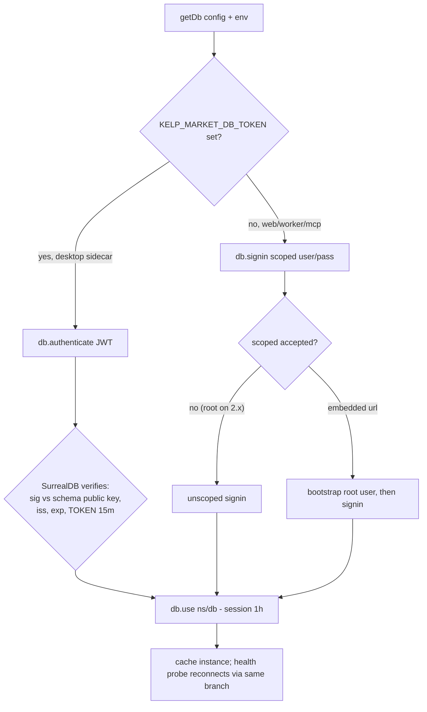
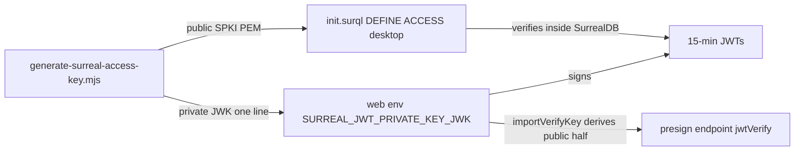

# Reference — data flows, verification, key rotation details

## Flow 1 — Login → grant exchange

```mermaid
sequenceDiagram
    participant U as Tauri desktop app
    participant S as Sidecar server (localhost)
    participant W as Market web (deployed)
    participant SSO as kelp-sso
    participant DB as SurrealDB (kelp-dev/prod)

    U->>SSO: login (native email → emailed OTP code; companies add TOTP step)
    SSO-->>U: session
    S->>W: POST /api/desktop/exchange (cookie or Bearer <sso token>)
    W->>SSO: GET /api/auth/get-session (forwarded cookie/bearer)
    SSO-->>W: session { user.id }
    W->>W: mintSurrealToken(user.id) — Ed25519, 15 min
    W-->>S: grant { KELP_MARKET_DB_TOKEN, KELP_DESKTOP_PRESIGN_URL, URL/NS/DB, S3_BUCKET, tokenExpiresAt }
    S->>S: grant cache (10 min TTL) + mirror into process.env
    Note over S,DB: next getDb(): db.authenticate(JWT)
    S->>DB: authenticate(JWT)
    DB->>DB: verify Ed25519 sig vs public key in schema (DEFINE ACCESS desktop)
    DB-->>S: session (1 h, record user = user:⟨accountId⟩)
```

Key points: the sidecar never sees a DB password or S3 keys; the JWT is verified by the
database itself, not by application code.

## Flow 2 — Publish (the upload path)



Idempotency: a retried publish computes the same CID (content-addressed bytes) and
adopts the existing asset in the `createAsset` step instead of creating a duplicate.

## Flow 3 — DB auth decision (every connection, every process)



## Flow 4 — Key material lifecycle



Rotation = rerun the generator → replace env value → replace PEM in schema → re-apply
schema. The public key is not secret; nothing else stores key material.

## Release train

The grant payload shape changed in this system. The updated web and the updated desktop
must ship together (desktop auto-updater picks up the new build). Older desktops keep
working only while the old env keys remain in the grant; the removal of user/pass keys
means an old desktop against a new web loses DB access — an old desktop can't use the
new payload either. **Deploy web + desktop in the same train.**

## Key rotation runbook

1. `node market/packages/db-ops/scripts/generate-surreal-access-key.mjs` → prints a new private JWK + public PEM.
2. Replace `SURREAL_JWT_PRIVATE_KEY_JWK` in the web env/secret (keep single-quoted in sourced files). Restart web.
3. Replace the `ALGORITHM EDDSA KEY` PEM in `market/packages/db/schemas/init.surql`;
   `OVERWRITE` makes the re-apply idempotent (`pnpm schema:apply` or init containers).
4. Desktops pick up new tokens on their next grant exchange (≤10 min). Old tokens die
   naturally (≤15 min). No user action.

## Verification checklist (all proven 2026-09-19/20 on kelp-dev)

- Schema: `INFO FOR DB` → `accesses: ['desktop']`.
- Token auth: minted JWT → `db.authenticate` → `RETURN $auth` = `user:⟨test-user-123⟩`
  exact; tampered and foreign-key tokens rejected; table reads work under the token
  session; `getDb()` logs `user=desktop-jwt`.
- Presign: valid request → 200 → PUT 200 → HeadObject shows exact content-type;
  guards: 401 (no auth), 400 (bad key / bad content type / 9 items); `prnu/` +
  `application/json` path works.
- Exchange: grant contains `KELP_MARKET_DB_TOKEN`, `KELP_DESKTOP_PRESIGN_URL`,
  `S3_BUCKET`, `tokenExpiresAt`; contains none of the removed credential keys.
- Publish E2E (desktop sidecar build, grant-only env, seeded local index):
  `results[].ok: true` with CID asset; S3 shows `data.jpg` + `presets/{sm,md,lg}.jpg`;
  DB row `desktopProcessed=true`, `thumbnailUrl=presets/md.jpg`, license stamped;
  **no** `job_queue` rows; local index flips to `published`.
- Regression: `pnpm --filter @kelp_digital/market-db test` 364/364 (mem:// user/pass
  path intact), web `svelte-check` 0 errors, web + desktop builds clean.
